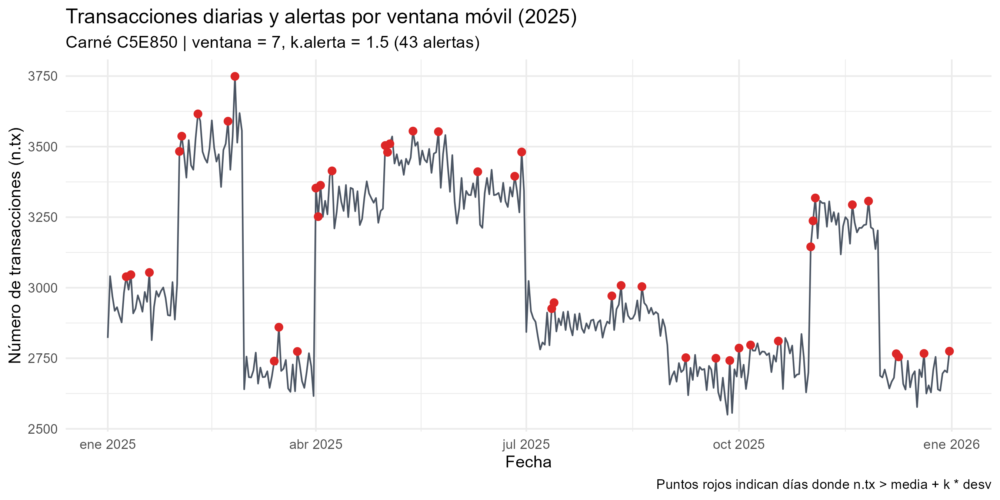

```{r setup, include=FALSE}
knitr::opts_chunk$set(echo = TRUE, warning = FALSE, message = FALSE)
library(dplyr)
library(readr)

# Carga de funciones modulares y parametros asignados
source("cod/funciones_tarea3.R")
params <- read.csv2("config/parametros_tarea3.csv")

# Carga de base de transacciones
tx <- read_csv2("data/transacciones_2025.csv", show_col_types = FALSE)
```

## 0. Hoja de respuestas

```{r respuestas, echo=FALSE}
# Calculo Ejercicio 1
v_asig <- as.integer(params$valor[params$parametro == "ventana"])
k_asig <- as.numeric(params$valor[params$parametro == "k.alerta"])

res_ej1_asig <- alerta.movil(tx, ventana = v_asig, k.alerta = k_asig)
res_ej1_comun <- alerta.movil(tx, ventana = 7, k.alerta = 2)

RESULTADO_1A <- sum(res_ej1_asig$alerta)
RESULTADO_1B <- as.character(res_ej1_asig$fecha[which(res_ej1_asig$alerta)[1]])
RESULTADO_1C <- sum(res_ej1_comun$alerta)

# Placeholders Ejercicios 2 y 3
RESULTADO_2A <- "PENDIENTE"
RESULTADO_2B <- "PENDIENTE"
RESULTADO_2C <- "PENDIENTE"
RESULTADO_2D <- "PENDIENTE"
RESULTADO_3A <- "PENDIENTE"
RESULTADO_3B <- "PENDIENTE"
RESULTADO_3C <- "PENDIENTE"

cat(
  paste0("RESULTADO_1A = ", RESULTADO_1A),
  paste0("RESULTADO_1B = ", RESULTADO_1B),
  paste0("RESULTADO_1C = ", RESULTADO_1C),
  paste0("RESULTADO_2A = ", RESULTADO_2A),
  paste0("RESULTADO_2B = ", RESULTADO_2B),
  paste0("RESULTADO_2C = ", RESULTADO_2C),
  paste0("RESULTADO_2D = ", RESULTADO_2D),
  paste0("RESULTADO_3A = ", RESULTADO_3A),
  paste0("RESULTADO_3B = ", RESULTADO_3B),
  paste0("RESULTADO_3C = ", RESULTADO_3C),
  sep = "\n"
)
```

## Ejercicio 1: Alertas por ventana móvil

```{r ej1_grafico, echo=FALSE}
# Aquí insertaremos la imagen del gráfico cuando esté lista
# 
```