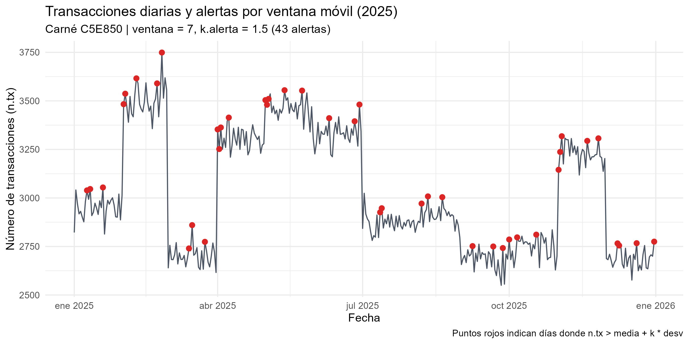
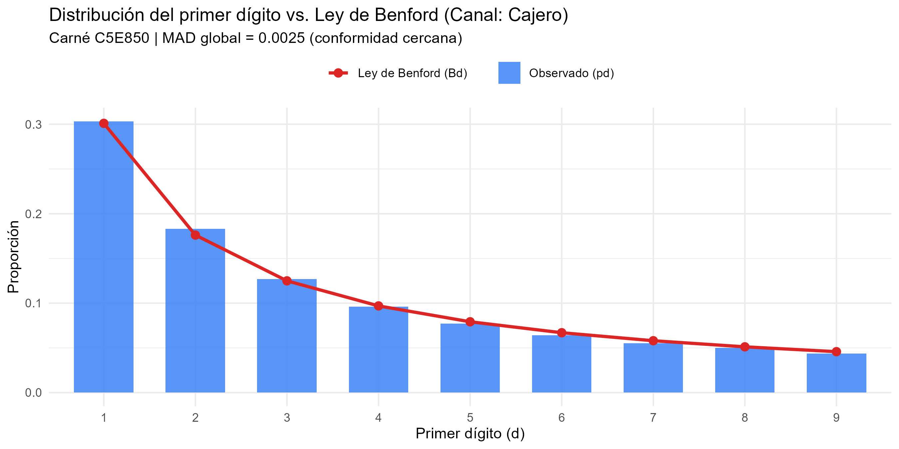

```{r setup, include=FALSE}
knitr::opts_chunk$set(echo = TRUE, warning = FALSE, message = FALSE)
library(dplyr)
library(readr)
library(ggplot2)

# Carga de funciones modulares y parametros asignados
source("cod/funciones_tarea3.R")
params <- read.csv2("config/parametros_tarea3.csv")

# Carga de base de transacciones
tx <- read_csv2("data/transacciones_2025.csv", show_col_types = FALSE)
cantones <- read_csv("data/cantones.csv", show_col_types = FALSE)
```

## 0. Hoja de respuestas

```{r respuestas, echo=FALSE}
# Calculo Ejercicio 1
v_asig <- as.integer(params$valor[params$parametro == "ventana"])
k_asig <- as.numeric(params$valor[params$parametro == "k.alerta"])

res_ej1_asig <- alerta.movil(tx, ventana = v_asig, k.alerta = k_asig)
res_ej1_comun <- alerta.movil(tx, ventana = 7, k.alerta = 2)

RESULTADO_1A <- sum(res_ej1_asig$alerta)
RESULTADO_1B <- as.character(res_ej1_asig$fecha[which(res_ej1_asig$alerta)[1]])
RESULTADO_1C <- sum(res_ej1_comun$alerta)

# Calculo Ejercicio 2
canal_asig <- as.character(params$valor[params$parametro == "canal.benford"])

res_ej2_asig <- benford.canton(tx, canal = canal_asig, cantones = cantones)
res_ej2_web  <- benford.canton(tx, canal = "Web", cantones = cantones)

RESULTADO_2A <- round(benford.mad(tx$monto_crc[tx$canal == canal_asig]), 4)
RESULTADO_2B <- res_ej2_asig$canton[1]
RESULTADO_2C <- sum(res_ej2_asig$mad > 0.015, na.rm = TRUE)
RESULTADO_2D <- res_ej2_web$canton[1]

# Calculo Ejercicio 3
tasa_asig  <- as.numeric(params$valor[params$parametro == "tasa.anual"])
canal_int  <- as.character(params$valor[params$parametro == "canal.interes"])

res_ej3_asig  <- valor.acumulado(tx, tasa.anual = tasa_asig, canal = canal_int)
res_ej3_comun <- valor.acumulado(tx, tasa.anual = 0.06, canal = "App")

RESULTADO_3A <- sprintf("%.2f", res_ej3_asig$va)
RESULTADO_3B <- sprintf("%.2f", res_ej3_asig$interes)
RESULTADO_3C <- sprintf("%.2f", res_ej3_comun$va)

cat(
  paste0("RESULTADO_1A = ", RESULTADO_1A),
  paste0("RESULTADO_1B = ", RESULTADO_1B),
  paste0("RESULTADO_1C = ", RESULTADO_1C),
  paste0("RESULTADO_2A = ", RESULTADO_2A),
  paste0("RESULTADO_2B = ", RESULTADO_2B),
  paste0("RESULTADO_2C = ", RESULTADO_2C),
  paste0("RESULTADO_2D = ", RESULTADO_2D),
  paste0("RESULTADO_3A = ", RESULTADO_3A),
  paste0("RESULTADO_3B = ", RESULTADO_3B),
  paste0("RESULTADO_3C = ", RESULTADO_3C),
  sep = "\n"
)
```

## Ejercicio 1: Alertas por ventana móvil

```{r ej1_grafico, echo=FALSE}
dir.create("info/figuras", recursive = TRUE, showWarnings = FALSE)

g_ej1 <- ggplot(res_ej1_asig, aes(x = fecha, y = n.tx)) +
  geom_line(color = "#4B5563", linewidth = 0.5) +
  geom_point(
    data = subset(res_ej1_asig, alerta == TRUE),
    aes(x = fecha, y = n.tx),
    color = "#DC2626",
    size = 2
  ) +
  labs(
    title = "Transacciones diarias y alertas por ventana móvil (2025)",
    subtitle = paste0("Carné C5E850 | ventana = ", v_asig, ", k.alerta = ", k_asig, " (", RESULTADO_1A, " alertas)"),
    x = "Fecha",
    y = "Número de transacciones (n.tx)",
    caption = "Puntos rojos indican días donde n.tx > media + k * desv"
  ) +
  theme_minimal()

ggsave("info/figuras/ejercicio1_alertas.png", plot = g_ej1, width = 9, height = 4.5, dpi = 300)

```

## Ejercicio 2: Ley de Benford por cantón

```{r ej2_grafico, echo=FALSE}
montos_canal <- tx$monto_crc[tx$canal == canal_asig]
primer_dig   <- montos_canal %/% 10^floor(log10(montos_canal))

df_benford <- data.frame(
  digito  = 1:9,
  obs     = as.numeric(table(factor(primer_dig, levels = 1:9))) / length(primer_dig),
  benford = log10(1 + 1 / (1:9))
)

g_ej2 <- ggplot(df_benford, aes(x = factor(digito))) +
  geom_col(aes(y = obs, fill = "Observado (pd)"), width = 0.65, alpha = 0.85) +
  geom_line(aes(y = benford, group = 1, color = "Ley de Benford (Bd)"), linewidth = 1.1) +
  geom_point(aes(y = benford, color = "Ley de Benford (Bd)"), size = 2.5) +
  scale_fill_manual(values = c("Observado (pd)" = "#3B82F6")) +
  scale_color_manual(values = c("Ley de Benford (Bd)" = "#DC2626")) +
  labs(
    title = paste0("Distribución del primer dígito vs. Ley de Benford (Canal: ", canal_asig, ")"),
    subtitle = paste0("Carné C5E850 | MAD global = ", RESULTADO_2A, " (conformidad cercana)"),
    x = "Primer dígito (d)",
    y = "Proporción",
    fill = NULL,
    color = NULL
  ) +
  theme_minimal() +
  theme(legend.position = "top")

ggsave("info/figuras/ejercicio2_benford.png", plot = g_ej2, width = 9, height = 4.5, dpi = 300)

```

**Conclusión:** No es fraude; al revisar la columna `n`, los cantones con mayor MAD tienen muestras muy pequeñas (por ejemplo, Aserrí con $n = 135$ o Montes de Oca con $n = 158$), por lo que la desviación responde a variabilidad muestral por tamaño de muestra reducido y no a manipulación de datos.